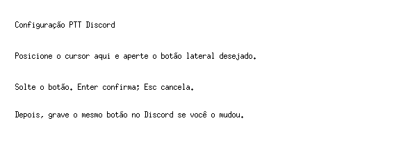

# Demonstração e teste manual

O seletor recebe o botão na própria janela. Aperte, solte e confirme com Enter.
Esc cancela. A figura é uma captura real do seletor em Xvfb; não demonstra áudio.

## Desktop existente

1. Instale com `./install.sh --install-deps` (integração antiga: `--migrate`).
2. Verifique o botão importado. Use `omarchy-ptt detect-discord` para consultar.
3. Abra uma chamada no Discord XWayland e confirme que o modo é Push-to-Talk.
4. Em um workspace com aplicativo Wayland, segure e solte: a voz deve acompanhar.
5. Segure, troque de workspace e solte: a voz deve parar sem novo clique.
6. Repita partindo de um aplicativo XWayland e confira que o foco não muda.
7. Abra **Configuração PTT Discord**, escolha outro botão lateral e confirme.
8. Grave esse mesmo botão no Discord e repita os passos 4–6.
9. Se já mudou o atalho no Discord, use `omarchy-ptt configure --from-discord`.
10. Confira `omarchy-ptt doctor`. Exporte o perfil para seu pack.

## Omarchy recém-instalado

Use uma máquina ou VM com Omarchy Lua, sem a integração antiga. Não é necessário
apagar a configuração atual para testar. Siga `FRESH-INSTALL.md` com um perfil
explícito no primeiro login, configure a conta Discord e repita o teste acima.

Registre versão de Omarchy, Hyprland, Discord e mapeamento do mouse; resultado do
hold/release, troca de workspace, foco, mudança de botão e próximo login. Não
publique logs brutos do Discord, dados da conta ou backups locais.

Estado da beta: veja `VALIDATION.md`. Testes de instalação em diretórios
isolados não equivalem a validação funcional de uma instalação limpa completa.
